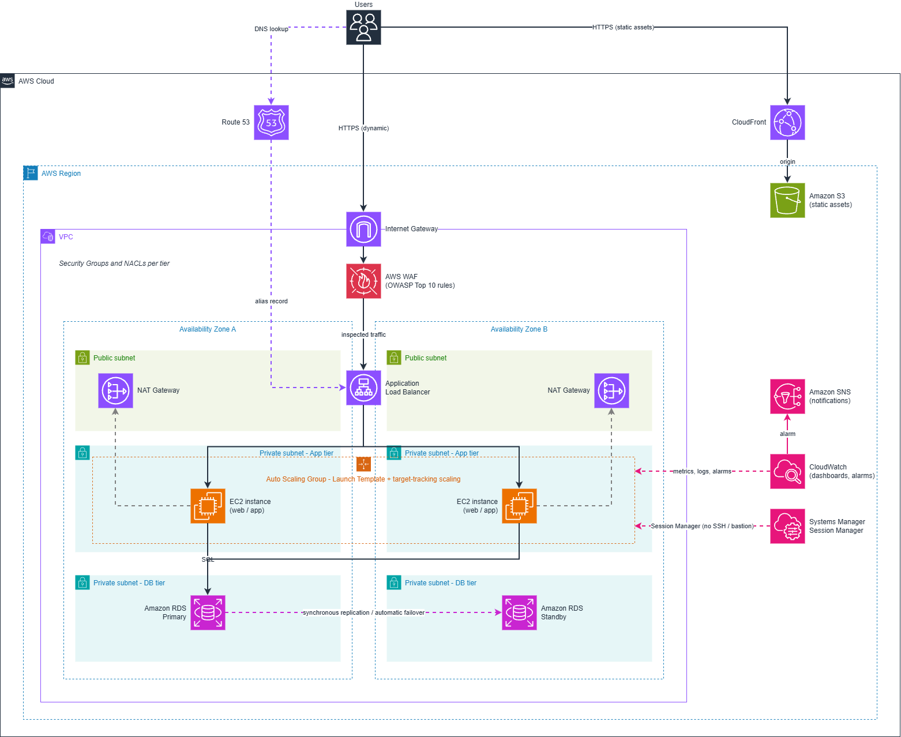
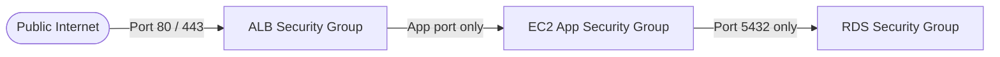

# 🚀 Scalable Web Application with ALB and Auto Scaling on AWS


**Author:** Abdelrhman Ahmed
**Program:** AWS Solutions Architect – Associate (SAA-C03) Graduation Project  
**Organization:** [Manara.tech](https://manara.tech/)

---

## 📌 Executive Summary

This repository contains modular **Terraform** code that deploys a highly available, scalable, and secure **3-tier web application** on Amazon Web Services (AWS).

The design removes single points of failure by spanning two Availability Zones in `<aws-region>`, keeping compute and data in private subnets, scaling EC2 capacity automatically with demand, and protecting the application edge with AWS WAF and Amazon CloudFront.

---

## 🏛️ Solution Architecture Diagram



> 💡 **Tip:** The editable source is [`MANARA-3Tier-AWS-Architecture.drawio`](./MANARA-3Tier-AWS-Architecture.drawio). Open it directly in [draw.io / diagrams.net](https://app.diagrams.net/).

### End-to-End Traffic & Data Flow

1. **DNS:** Users resolve the domain through **Amazon Route 53**. An **Alias record** points to the Application Load Balancer, and **Route 53 health checks** monitor endpoint availability.
2. **Edge caching:** Static assets are cached at **Amazon CloudFront** edge locations (S3 origin), which lowers latency and offloads requests from the application tier.
3. **Public ingress:** Dynamic traffic enters the VPC through the **Internet Gateway** and reaches the **Application Load Balancer** in the public subnets, protected by **AWS WAF** with OWASP Top 10 managed rules.
4. **Private compute tier:** The ALB forwards requests to an **Auto Scaling Group** of EC2 instances in private application subnets. The instances have no direct public ingress.
5. **Private data tier:** The application connects to an **Amazon RDS Multi-AZ** database in isolated private DB subnets. The primary replicates synchronously to a standby in the second AZ for automatic failover.
6. **Outbound access:** Private instances reach the internet (patches, packages) through **NAT Gateways** in the public subnets.
7. **Bastion-free management:** Engineers connect with **AWS Systems Manager Session Manager**. No SSH port is exposed and no bastion host is needed.
8. **Observability:** **Amazon CloudWatch** dashboards and alarms track the platform, and **Amazon SNS** sends alarm notifications.

---

## ⚙️ Key AWS Services & Architectural Decisions

| Service                   | Role & Implementation Details                                                                                                                                                                                 |
| :------------------------ | :------------------------------------------------------------------------------------------------------------------------------------------------------------------------------------------------------------ |
| **Amazon VPC**            | Custom VPC with public, private-app, and private-DB subnets across 2 AZs, plus Internet Gateway, route tables, and custom **NACLs** for subnet-level defense in depth. CIDR ranges are set in `variables.tf`. |
| **NAT Gateways**          | Outbound internet access for private subnets, deployed per AZ so egress survives an AZ failure.                                                                                                               |
| **ALB + WAF**             | Layer 7 load balancing with target group health checks, protected by an **AWS WAF Web ACL** using OWASP Top 10 managed rule groups.                                                                           |
| **EC2 + Auto Scaling**    | Launch Template plus Auto Scaling Group across both private app subnets, using **target tracking scaling policies** to follow demand.                                                                         |
| **Amazon RDS (Multi-AZ)** | Managed PostgreSQL with synchronous Multi-AZ replication and automated failover, in private DB subnets.                                                                                                       |
| **Amazon CloudFront**     | CDN for static asset caching and HTTPS delivery.                                                                                                                                                              |
| **Route 53**              | Alias record to the ALB, with health checks.                                                                                                                                                                  |
| **Systems Manager**       | IAM-authenticated Session Manager for instance access with no SSH keys or bastion host.                                                                                                                       |
| **CloudWatch + SNS**      | Dashboards and metric alarms, with SNS notifications.                                                                                                                                                         |

---

## 🔒 Layered Security & Defense-in-Depth

Network traffic follows the **principle of least privilege** using chained Security Groups:



### Security Group Matrix

| Security Group | Inbound                         | Outbound              | Purpose                                    |
| :------------- | :------------------------------ | :-------------------- | :----------------------------------------- |
| **ALB SG**     | `TCP 80, 443` from `0.0.0.0/0`  | App port to App SG    | Public entry point for web traffic.        |
| **App SG**     | App port **only from** ALB SG   | All traffic (via NAT) | Web tier. No direct internet ingress.      |
| **DB SG**      | `TCP 5432` **only from** App SG | None                  | Database tier, isolated from the internet. |

### Network ACL (NACL) Matrix

Stateless subnet-boundary filtering adds a second layer on top of the Security Groups:

| Subnet Tier     | Inbound                                                                                                  | Outbound                                                                                                   |
| :-------------- | :------------------------------------------------------------------------------------------------------- | :--------------------------------------------------------------------------------------------------------- |
| **Public**      | • `TCP 80` from `0.0.0.0/0`<br>• `TCP 443` from `0.0.0.0/0`<br>• Ephemeral `1024-65535` from `0.0.0.0/0` | • All traffic to `0.0.0.0/0`                                                                               |
| **Private App** | • App port from VPC CIDR<br>• Ephemeral `1024-65535` from `0.0.0.0/0`                                    | • `TCP 80/443` to `0.0.0.0/0` (via NAT)<br>• `TCP 5432` to VPC CIDR (RDS)<br>• Ephemeral to VPC CIDR (ALB) |
| **Private DB**  | • `TCP 5432` from VPC CIDR                                                                               | • Ephemeral `1024-65535` to VPC CIDR                                                                       |

---

## 📂 Repository File Structure

> Replace this block with the output of `tree -L 3 -I .terraform` so it matches the repo exactly.

```text
.
├── MANARA-3Tier-AWS-Architecture.png      # Solution architecture diagram
├── MANARA-3Tier-AWS-Architecture.drawio   # Editable draw.io source
├── README.md                              # Project documentation
└── terraform/
    ├── main.tf                            # Root module wiring
    ├── variables.tf                       # Input variables
    ├── outputs.tf                         # Exported endpoints and IDs
    └── modules/
        ├── vpc/                           # VPC, subnets, IGW, NAT, route tables, NACLs, SGs
        ├── alb/                           # Load balancer, target group, listeners
        ├── asg/                           # Launch Template, Auto Scaling Group, scaling policies
        ├── rds/                           # Multi-AZ RDS and DB subnet group
        ├── cloudfront/                    # CDN distribution
        ├── waf/                           # WAF Web ACL
        ├── route53/                       # Alias record and health checks
        ├── ssm/                           # IAM role and instance profile for Session Manager
        └── monitoring/                    # CloudWatch dashboard, alarms, SNS topic
```

---

## 🚀 Deployment Guide

### Prerequisites

- [Terraform](https://www.terraform.io/downloads.html) installed.
- [AWS CLI](https://aws.amazon.com/cli/) configured with sufficient permissions (`aws configure`).
- A domain and Route 53 hosted zone for the alias record and health checks.

### 1. Clone the Repository

```bash
git clone https://github.com/4abdelrhman/MANARA-SAA-3Tier-web.git
cd MANARA-SAA-3Tier-web/<root-module-dir>
```

### 2. Configure Variables

```bash
cp terraform.tfvars.example terraform.tfvars   # then edit the values
```

### 3. Initialize, Validate & Plan

```bash
terraform init
terraform validate
terraform plan
```

### 4. Deploy

```bash
terraform apply
```

_Deployment can take 10+ minutes, mostly for the Multi-AZ RDS instance and the CloudFront distribution._

### 5. Access the Application

```bash
terraform output
```

Open the ALB DNS name or the CloudFront domain from the outputs in your browser.

---

## 🧪 Verification & High Availability Testing

### Plan Verification

```bash
terraform validate
terraform plan
```

```text
Plan: 65 to add, 0 to change, 0 to destroy.
```

Optional security scan:

```bash
checkov -d .
```

_Add your own `terraform plan` / Checkov results here, and link the full log if you keep one._

### Test 1: Load Balancing & High Availability

1. Refresh the application page several times.
2. If your user-data page shows the instance ID or AZ, confirm it alternates between the two Availability Zones.

### Test 2: Auto Scaling Self-Healing

1. In the EC2 console, terminate one of the web instances.
2. The ALB marks it unhealthy and the **Auto Scaling Group launches a replacement** to restore the desired capacity.

### Test 3: RDS Multi-AZ Failover

1. In the RDS console, select `<db-identifier>` → **Actions** → **Reboot**.
2. Choose **Reboot with failover**.
3. Confirm the standby in the second AZ is promoted and the application reconnects.

---

## 🧹 Teardown

To avoid ongoing AWS charges (NAT Gateways, RDS, and the ALB all bill hourly):

```bash
terraform destroy
```

---

## 🎓 Deliverables Checklist

- [ ] **Solution architecture diagram** with editable draw.io source
- [ ] **Public GitHub repository** with modular Terraform
- [ ] **VPC:** public/private subnets across 2 AZs, NAT Gateways, Security Groups, NACLs
- [ ] **Compute:** EC2 Launch Template + Auto Scaling Group with target tracking policies
- [ ] **Load balancing & security:** ALB with AWS WAF (OWASP Top 10 rules)
- [ ] **Database:** RDS Multi-AZ with automated failover
- [ ] **Edge delivery:** CloudFront static asset caching
- [ ] **DNS:** Route 53 alias record and health checks
- [ ] **Bastion-free access:** Systems Manager Session Manager
- [ ] **Monitoring:** CloudWatch dashboard, alarms, and SNS notifications
